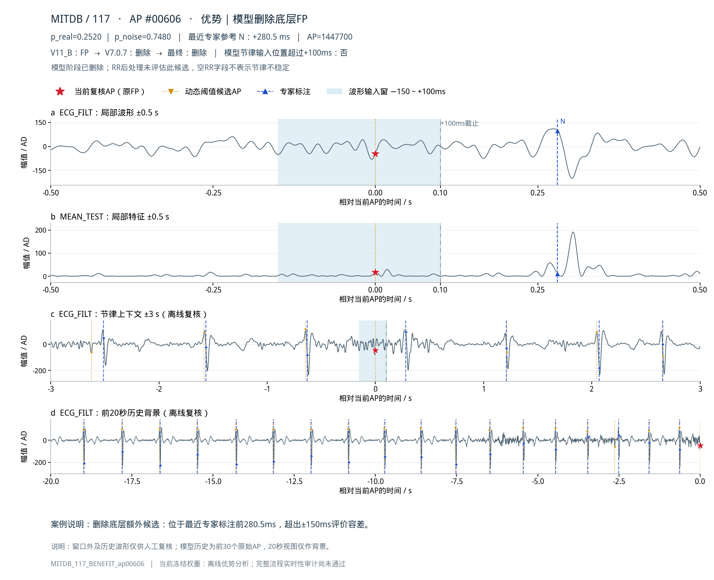
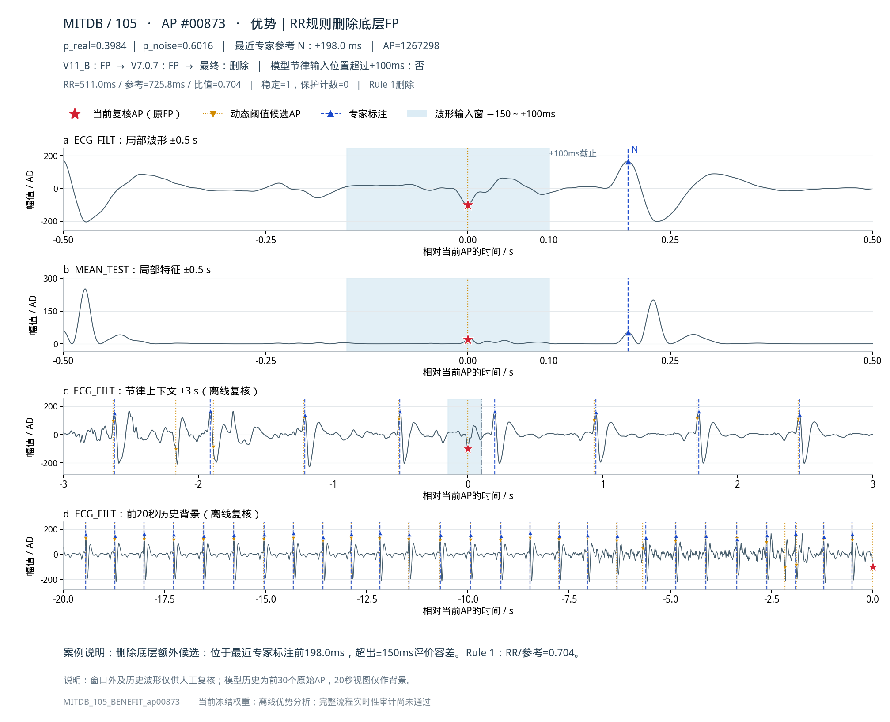
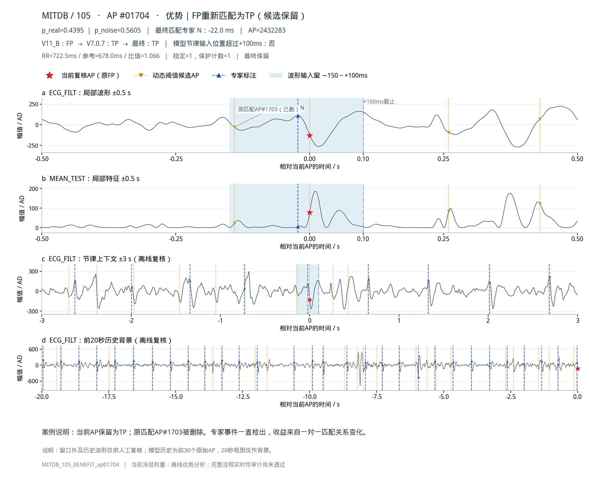
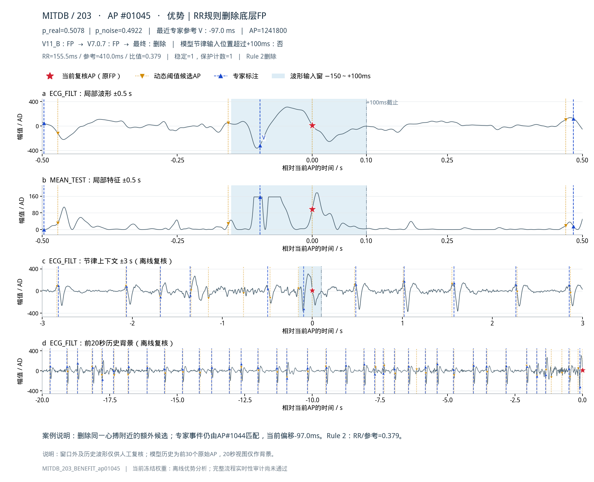
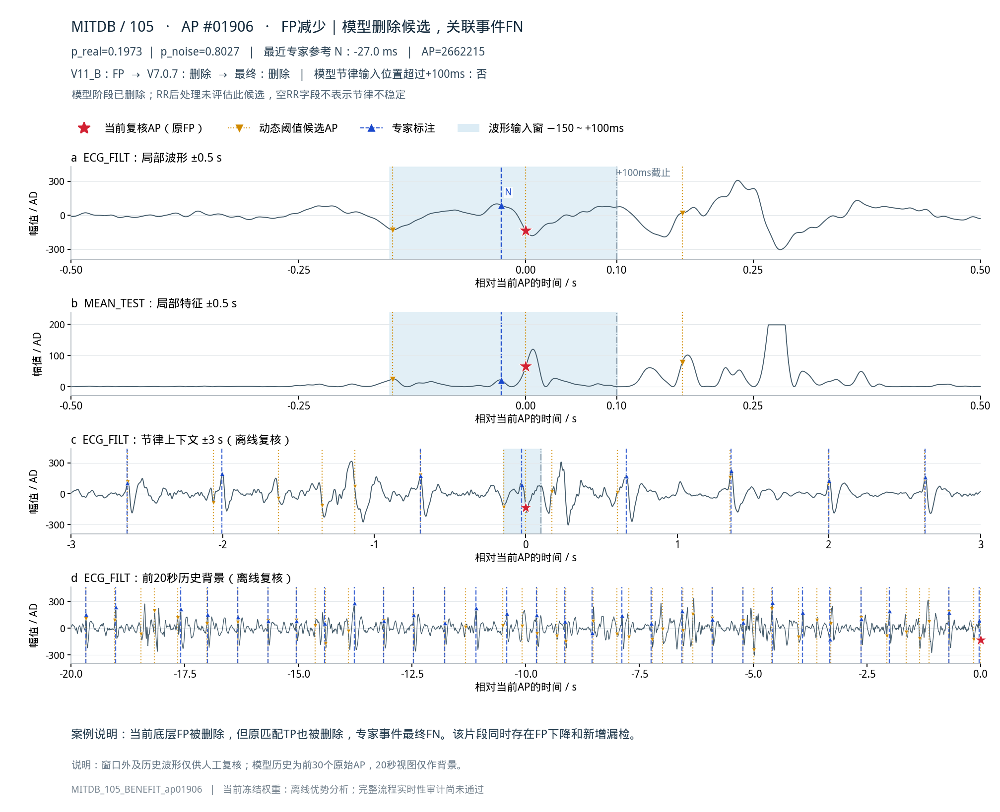

# 优势部分：报告代表案例

当前冻结模型的FP净减少为256：直接删除250例，重新匹配为TP 6例。前三例分别展示模型删除、RR删除、匹配变化。

## 模型删除评价容差外的额外候选

当前AP在底层为FP，位于最近专家参考标注前280.5ms，超出±150ms评价容差。模型p_real=0.2520、p_noise=0.7480，未通过原0.70噪声阈值；RR未评估此候选。

案例：`MITDB_117_BENEFIT_ap00606`。

## Rule 1删除稳定节律中的额外候选

当前AP在底层为FP，位于最近专家参考标注前198.0ms，超出±150ms评价容差。模型以p_real=0.3984保留，随后Rule 1删除；RR=511.0ms，参考RR=725.8ms，比值=0.704，历史稳定=1、cooldown=0。

案例：`MITDB_105_BENEFIT_ap00873`。

## 候选保留，FP重新匹配为TP

当前AP在底层被评价为FP，但未被模型或RR删除；原匹配AP#1703被模型删除后，当前AP以p_real=0.4395重新匹配专家事件1696（N，相对AP-22.0ms）。该专家事件在各阶段均检出，这是候选匹配变化，不是新增检出一个心搏。

案例：`MITDB_105_BENEFIT_ap01704`。

## Rule 2删除同一心搏附近的额外候选

底层FP位于最近专家标注-97.0ms，在±150ms匹配容差内；该专家事件在底层已由AP#1044匹配。删除当前额外候选后，该专家事件仍由AP#1044检出。模型以p_real=0.5078保留，随后Rule 2删除；RR=155.5ms，参考RR=410.0ms，比值=0.379，历史稳定=1、cooldown=1。此前3秒低置信AP数=3，前一保留概率减当前概率=0.359。

案例：`MITDB_203_BENEFIT_ap01045`。

## 同一片段兼有FP减少与新增FN

底层FP位于最近专家标注-27.0ms，在±150ms匹配容差内；该专家事件在底层已由AP#1905匹配。当前FP候选及原匹配TP候选均被删除，该专家事件最终漏检。同一片段同时计入候选级FP减少和事件级新增FN，不能据FP标签把该波形判为噪声。模型p_real=0.1973、p_noise=0.8027，未通过原0.70噪声阈值；RR未评估此候选。

案例：`MITDB_105_BENEFIT_ap01906`。

## FP下降与FN增加的关联复核

两例容差内候选删除同时伴随对应专家事件新增FN。原177例图集的关联FN图已放入 `paired_FN_context/`。

- `MITDB_105_BENEFIT_ap01906` 对应 `MITDB_105_FN_event01870_ap01905`。

- `MITDB_203_BENEFIT_ap00891` 对应 `MITDB_203_FN_event00887_ap00890`。
